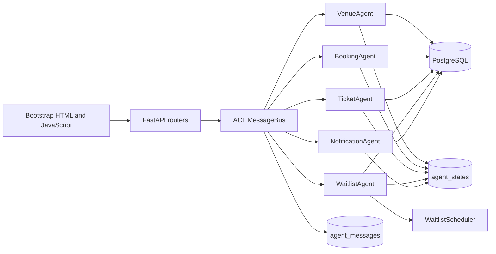

# EventSphere

University event, ticketing, venue-hire, and admission-management platform.

## Overview

EventSphere provides a web application and FastAPI API for publishing university
events, managing venues and ticket categories, booking tickets, issuing QR
tickets, processing waitlists, accepting private venue-hire requests, and
checking attendees in at the gate.

### Problem statement

University event administration is often split across spreadsheets, manual
payments, email notifications, and separate admission lists. This makes
capacity control, venue scheduling, waitlist processing, and secure admission
validation difficult to coordinate.

### Aim and objectives

The project aims to provide one authenticated platform that:

- manages events, venues, ticket categories, and private venue hire;
- prevents ticket overselling with PostgreSQL row locking;
- creates simulated payments and secure digital QR tickets;
- supports waitlist registration, FIFO processing, expiry, and idempotency;
- coordinates domain responsibilities through five ACL-based agents; and
- gives gate staff a controlled ticket check-in workflow.

## Features and roles

| Role | Implemented capabilities |
| --- | --- |
| `ADMIN` | Manage venues, events, ticket categories, dashboard data, waitlist processing, and gate check-in |
| `ORGANISER` | Manage venues, events, ticket categories, and event publishing/cancellation |
| `GATE_STAFF` | Use `/scanner` and check in valid QR tickets |
| `ATTENDEE` | Browse events, book and cancel eligible bookings, view tickets and notifications, join waitlists, and submit venue-hire requests |

Implemented user-facing areas include authentication, event discovery, event
details and booking, My Bookings, My Tickets, My Waitlist, Notifications,
Private Venue Hire, administration pages, and the gate scanner.

## Technology stack

- Python 3.x
- FastAPI and Uvicorn
- PostgreSQL with `psycopg`
- Pydantic
- HTML, CSS, JavaScript, and Bootstrap
- `qrcode` for QR image generation
- Pytest and HTTPX

No React, Node.js, SQLAlchemy, SQLite, Redis, Celery, or Django is used.

## Architecture

The FastAPI application exposes REST endpoints and serves the static HTML
frontend. Domain operations use direct parameterized PostgreSQL queries.
Agent-to-agent work is sent through the in-process ACL message bus.



### Five agents

- **VenueAgent** checks venue capacity and scheduling conflicts, calculates
  private-hire prices, proposes alternatives, and creates confirmed hire
  requests when rules permit.
- **BookingAgent** validates attendee bookings, locks ticket categories,
  performs simulated payment, creates tickets, and sends confirmation
  notifications.
- **TicketAgent** validates gate staff, locks tickets during check-in, rejects
  invalid/used/cancelled tickets, and records check-in metadata.
- **WaitlistAgent** accepts attendee waitlist entries, processes entries in
  FIFO order, expires old entries, and uses `waitlist_id` idempotency to avoid
  duplicate bookings.
- **NotificationAgent** persists user notifications in PostgreSQL.

Messages use `REQUEST`, `AGREE`, `REFUSE`, `PROPOSE`, `INFORM`, and `FAILURE`
performatives. Each `ACLMessage` contains `sender`, `receiver`, `performative`,
`content`, `conversation_id`, and `timestamp`. The bus logs delivered messages
in `agent_messages`; agent state is stored in `agent_states`.

The waitlist scheduler sends an `INFORM` message to expire entries. It starts
with the FastAPI lifespan and is cancelled during shutdown.

## Project structure

```text
EventSphere/
├── app/
│   ├── agents/                 # ACL message bus and five agents
│   ├── static/                 # CSS and browser JavaScript
│   ├── templates/              # HTML pages
│   ├── auth.py                 # Registration, login, sessions
│   ├── database.py             # psycopg connection helper
│   ├── events.py               # Event and ticket-category APIs
│   ├── venues.py               # Venue APIs
│   ├── bookings.py             # Booking and cancellation APIs
│   ├── ticket.py               # Ticket, QR, and check-in APIs
│   ├── waitlist.py             # Waitlist APIs
│   ├── venue_hire.py           # Private venue-hire APIs
│   ├── notifications.py        # Notification APIs
│   ├── dashboard.py            # Admin dashboard APIs
│   └── main.py                 # FastAPI application and lifecycle
├── database/migrations/        # PostgreSQL migrations
├── tests/                      # Unit, route, scheduler, and integration tests
├── requirements.txt
└── README.md
```

## Installation and configuration

### Windows PowerShell

```powershell
py -3 -m venv venv
.\venv\Scripts\Activate.ps1
python -m pip install --upgrade pip
python -m pip install -r requirements.txt
```

Create a PostgreSQL database and configure the connection without placing
credentials in source control:

```powershell
$env:PGHOST = "localhost"
$env:PGPORT = "5432"
$env:PGDATABASE = "eventsphere_db"
$env:PGUSER = "postgres"
$env:PGPASSWORD = "<your-local-password>"
```

The application reads these variables in `app/database.py`. `.env` files are
ignored by Git, but this project does not automatically load `.env` files.

### Database setup

The repository does not contain a complete bootstrap schema dump. The existing
application expects the tables described in
[docs/DATABASE.md](docs/DATABASE.md) to already exist.

Before applying `database/migrations/001_waitlist_idempotency.sql` to an
existing database, inspect the current `waitlist_status_check` definition and
existing status values. The migration adds `bookings.waitlist_id`, the
waitlist idempotency index, the active waitlist uniqueness index, and the
`FULFILLED` status. Do not run it blindly against production data.

### Start the application

```powershell
python -m uvicorn app.main:app --reload
```

For a Render-style process:

```text
uvicorn app.main:app --host 0.0.0.0 --port $PORT
```

## API documentation

With the application running, open:

- Swagger UI: `http://127.0.0.1:8000/docs`
- ReDoc: `http://127.0.0.1:8000/redoc`

The endpoint inventory and role requirements are documented in
[docs/API.md](docs/API.md).

## Architecture and academic materials

- [Database documentation](docs/DATABASE.md)
- [Architecture and Mermaid diagrams](docs/ARCHITECTURE.md)
- [Final project report outline](docs/PROJECT_REPORT.md)
- [Presentation outline](docs/PRESENTATION.md)
- [Screenshot checklist](docs/SCREENSHOTS.md)
- [Academic submission structure](docs/ACADEMIC_SUBMISSION.md)

## Testing

```powershell
python -m compileall -q app tests
python -m pytest -v
git diff --check
```

Database-backed tests require the PostgreSQL environment variables. Tests that
do not require the database can run without them. Do not process real waitlist
entries while testing.

## Security and operational notes

- Passwords use PBKDF2-HMAC-SHA256 with a random salt.
- Session tokens are random and only their SHA-256 hashes are stored.
- SQL uses psycopg parameter binding.
- Ticket QR endpoints verify booking ownership.
- Gate check-in requires an active `GATE_STAFF` or `ADMIN` user.
- `.env`, virtual environments, caches, bytecode, and local database files are
  ignored by `.gitignore`.
- No database password, token, or API key belongs in Git, documentation, or
  screenshots.
- CORS is not enabled by the current application; configure a deliberate
  allowlist before adding cross-origin clients.

## Deployment preparation

The repository includes [render.yaml](render.yaml) as a deployment blueprint.
It defines a web service only and does not provision a database or contain
secret values. Configure a managed PostgreSQL database separately, then set:

- build command: `pip install -r requirements.txt`
- start command: `uvicorn app.main:app --host 0.0.0.0 --port $PORT`
- a managed PostgreSQL database
- `PGHOST`, `PGPORT`, `PGDATABASE`, `PGUSER`, and `PGPASSWORD` environment
  variables

The service health check is `/health`. Render deployment remains a manual
operation and is not claimed as complete until the deployed URL has been
tested.

Apply and verify the database schema and migration before starting production
traffic. The application has not been deployed or production-tested from this
repository.

## Academic submission materials

[docs/ACADEMIC_SUBMISSION.md](docs/ACADEMIC_SUBMISSION.md) contains the
submission-ready structure: introduction, scope, requirements, architecture,
database design, agent design, implementation, testing, limitations, future
work, and conclusion.

Screenshots still to capture manually:

1. attendee event discovery and event details;
2. confirmed booking and QR ticket;
3. waitlist and notification pages;
4. private venue-hire availability/history;
5. admin dashboard;
6. gate scanner with a test ticket.

## GitHub workflow

Inspect changes before committing:

```powershell
git status
git diff --check
git diff
```

After review, commit locally without secrets:

```powershell
git add README.md docs app database tests
git commit -m "Prepare EventSphere documentation and deployment"
git push origin main
```

The final commit and push require owner review and approval. Do not force-push
or rewrite history.

## Project status

The implementation is prepared for academic review. Live PostgreSQL
integration, Render deployment, production migration execution, and the
screenshots listed above still require manual completion.
