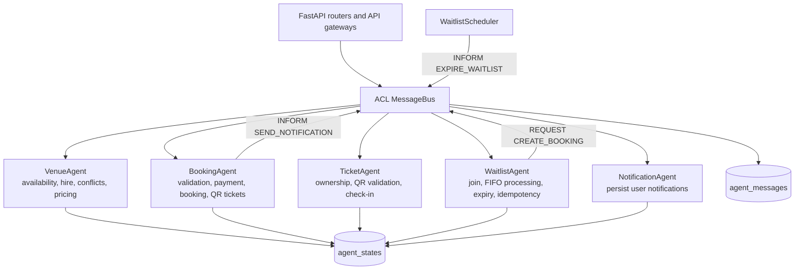
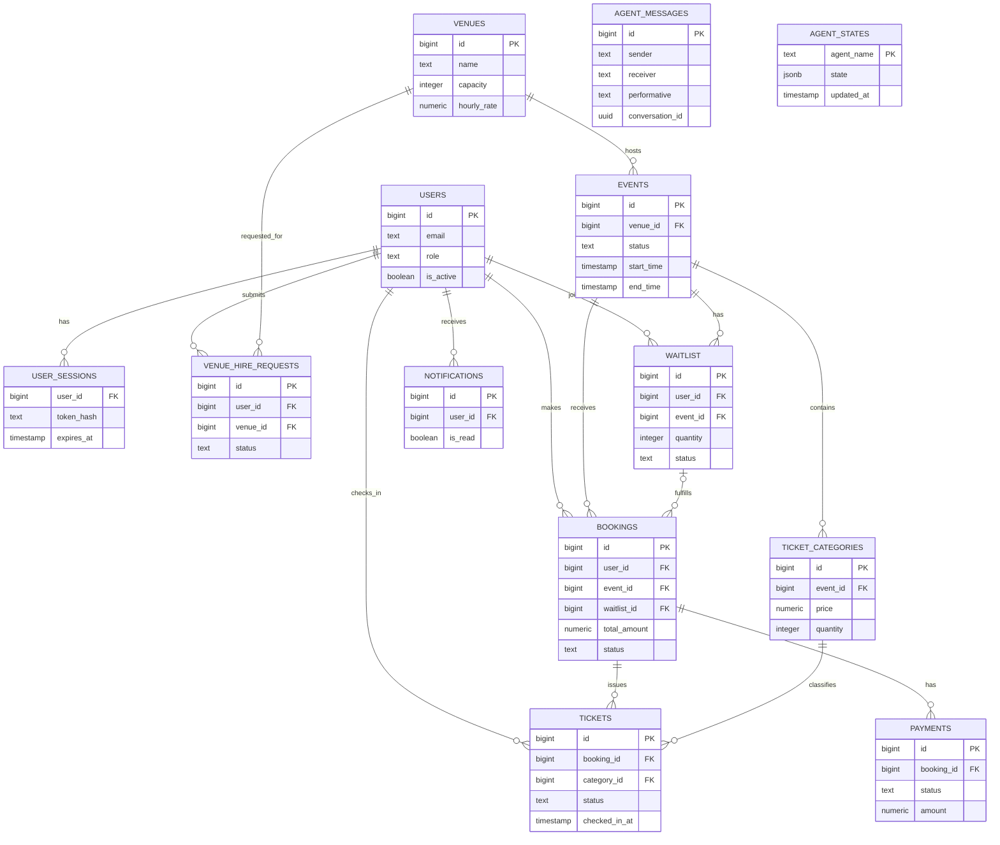

# EventSphere Architecture and Diagrams

These diagrams describe the architecture implemented in the repository. The
message bus is an in-process Python component; no external broker, payment
provider, email provider, or SMS provider is configured.

## System architecture

```mermaid
flowchart LR
    Browser[HTML CSS Bootstrap JavaScript] --> FastAPI[FastAPI application]
    FastAPI --> Routers[Auth event venue booking ticket waitlist hire dashboard routers]
    Routers --> Bus[In-process ACL MessageBus]
    FastAPI --> Static[Static files and HTML templates]
    Bus --> Agents[Five domain agents]
    Agents --> PostgreSQL[(PostgreSQL)]
    FastAPI --> PostgreSQL
    Scheduler[Waitlist expiry scheduler] --> Bus
    Health[/health] --> FastAPI
```

## Agent architecture



All ACL messages contain `sender`, `receiver`, `performative`, `content`,
`conversation_id`, and `timestamp`. Supported performatives are `REQUEST`,
`AGREE`, `REFUSE`, `PROPOSE`, `INFORM`, and `FAILURE`.

## Database ER diagram

The following entities and relationships are the tables referenced by the
application SQL and the applied waitlist idempotency migration. Confirm exact
constraint names against the deployment database before production migration.



## Runtime lifecycle

`app.main` creates the agent runtime during FastAPI startup, optionally
restores persisted agent state, starts the waitlist expiry task for local
development, and cancels the task during shutdown. When the Vercel runtime
marker is present, the infinite task is not started; an authenticated
`POST /cron/waitlist-expiry` request sends the same `INFORM /
EXPIRE_WAITLIST` message through the MessageBus. PostgreSQL credentials are
supplied through environment variables; no credentials are stored in the
repository.
