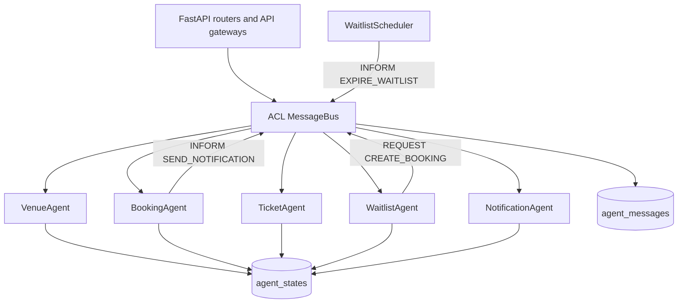
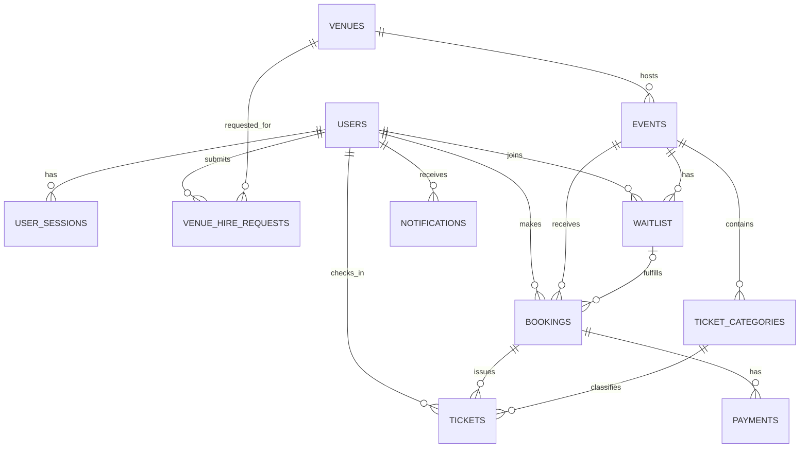

# EventSphere
## University Event, Ticketing, Venue-Hire, and Admission-Management Platform

### Final-Year Project Report

**Student:** `[PLACEHOLDER: Student name]`
**Student ID:** `[PLACEHOLDER: Student ID]`
**Programme:** `[PLACEHOLDER: Programme or course]`
**University:** `[PLACEHOLDER: University name]`
**Supervisor:** `[PLACEHOLDER: Supervisor name]`
**Submission date:** `[PLACEHOLDER: Submission date]`

> **Evidence note:** This report describes the implementation in the EventSphere
> repository. Claims about production deployment, live database operation, and
> screenshots are intentionally separated from verified implementation claims.
> Screenshot placeholders must be replaced only with authentic captures from a
> configured test or deployment environment.

---

## Abstract

EventSphere is a web-based university event-management platform designed to
centralise event publication, ticket booking, digital ticket presentation,
gate admission, private venue hire, notifications, and waitlist processing.
The system combines a FastAPI backend, PostgreSQL persistence, a responsive
HTML/CSS/JavaScript and Bootstrap frontend, and an in-process agent runtime
connected through an Agent Communication Language (ACL) message bus.

The platform supports role-based workflows for administrators, organisers,
gate staff, and attendees. Attendees can discover events, book tickets,
receive simulated payment and digital QR tickets, cancel eligible bookings,
join waitlists, view notifications, and submit private venue-hire requests.
Authorised staff can validate QR tickets and record admission. Administrative
and organiser functions provide management of venues, events, and ticket
categories.

Five domain agents divide responsibility across venue operations, booking,
tickets, waitlists, and notifications. Agent messages include sender,
receiver, performative, content, conversation identifier, and timestamp.
Delivered messages are logged in PostgreSQL, and agent state can be persisted
and restored. The completed automated verification result for the project is
**69 passed tests**. This report documents the implemented system, its
architecture, database design, testing methodology, limitations, and
potential future improvements.

**Keywords:** event management, ticketing, QR admission, PostgreSQL, FastAPI,
multi-agent system, ACL communication, waitlist idempotency.

---

## 1. Introduction

Universities organise academic, cultural, sporting, social, and community
events that require coordinated management of venues, capacity, ticket
inventory, attendees, payments, and admission. When these activities are
handled through separate spreadsheets, manual payment records, email
communication, and disconnected admission lists, operational errors become
more likely. Common consequences include overselling, duplicated bookings,
unclear waitlist status, delayed communication, and inefficient gate
verification.

EventSphere was developed as an integrated platform for these activities. It
provides a browser-based interface backed by FastAPI and PostgreSQL. The
system also uses an agent-based design to separate major operational
responsibilities while allowing them to communicate through a common ACL
message bus.

The project is intentionally implemented without React, Node.js, Django,
SQLAlchemy, Redis, Celery, or an external message broker. The frontend uses
HTML, CSS, JavaScript, and Bootstrap, while the backend uses direct
parameterised PostgreSQL queries through `psycopg`.

---

## 2. Problem Statement

A university event process commonly involves the following related tasks:

1. creating and publishing events;
2. assigning venues and ticket categories;
3. controlling ticket capacity;
4. collecting and recording booking payments;
5. communicating booking and waitlist updates;
6. issuing admission evidence;
7. validating attendees at the gate; and
8. managing private venue-hire requests.

If these tasks are performed using disconnected systems, staff may not have a
consistent view of availability or booking status. Manual capacity updates can
result in overselling. Waitlist retries can result in duplicate bookings.
Paper or manually checked admission lists are difficult to secure and update.
Attendees may also lack a single location for bookings, tickets,
notifications, and waitlist information.

EventSphere addresses this problem by providing one authenticated platform
with database-backed transactions, role-based access, digital QR tickets,
waitlist processing, venue availability checks, and agent-mediated domain
communication.

---

## 3. Aim and Objectives

### 3.1 Aim

The aim of EventSphere is to provide a secure and coordinated platform for
university event administration, ticket booking, venue hire, waitlist
processing, digital admission, and operational communication.

### 3.2 Objectives

The implemented objectives are to:

- provide registration, login, logout, and authenticated sessions;
- support role-based access for administrators, organisers, attendees, and
  gate staff;
- manage venues, events, and ticket categories;
- publish events and expose them through event discovery pages;
- prevent ticket overselling using PostgreSQL transaction and row-locking
  behaviour;
- create simulated successful payments and digital QR tickets;
- allow attendees to view tickets and booking information;
- support eligible booking cancellation and simulated refund processing;
- support waitlist registration, FIFO processing, expiry, and idempotency;
- support private venue-hire availability, price estimation, alternatives,
  and request history;
- provide attendee notifications;
- provide gate staff with a QR validation and check-in workflow;
- coordinate domain operations through five ACL-based agents; and
- persist agent messages and agent state in PostgreSQL.

---

## 4. Requirements

### 4.1 Functional requirements

| Area | Implemented requirement |
|---|---|
| Authentication | Registration, login, logout, session tokens, and authenticated route protection |
| Roles | `ADMIN`, `ORGANISER`, `ATTENDEE`, and `GATE_STAFF` access rules |
| Events | Event creation, management, publication, cancellation, and discovery |
| Venues | Venue management, capacity, hourly rate, and private-hire availability |
| Ticket categories | Event-specific categories, prices, and quantities |
| Booking | Ticket booking, capacity validation, booking records, and simulated payment |
| Cancellation | Eligible booking cancellation, simulated refund, and ticket cancellation |
| Tickets | Digital ticket records, ticket status, QR generation, and ownership checks |
| Check-in | Gate-staff and administrator QR validation and admission recording |
| Waitlist | Joining, active-entry prevention, FIFO processing, expiry, and idempotency |
| Venue hire | Availability checks, price estimates, alternatives, and request history |
| Notifications | User notifications, read state, and owner-restricted retrieval |
| Administration | Dashboard statistics, recent bookings, and agent-message information |
| Agent system | Five agents, ACL messages, message logging, and persisted state |

### 4.2 Non-functional requirements

- **Persistence:** PostgreSQL is used for application data, agent messages,
  and agent state.
- **Security:** Passwords are stored using PBKDF2-HMAC-SHA256 with random
  salts. Session tokens are random and only their SHA-256 hashes are stored.
- **Authorisation:** Protected operations verify the authenticated user and
  role. Ticket and notification retrieval is ownership-aware.
- **Consistency:** Parameterised SQL, transaction boundaries, row locking,
  and database constraints protect capacity and idempotency operations.
- **Usability:** The frontend uses responsive Bootstrap layouts, loading
  states, empty states, error messages, status badges, and accessible focus
  styles.
- **Maintainability:** Domain responsibilities are separated into FastAPI
  modules and five agents.
- **Deployability:** Render preparation files and environment-variable
  configuration are provided, but deployment remains a manual operation.

---

## 5. Methodology

Development followed an incremental, source-grounded approach:

1. **Repository inspection:** Existing backend modules, templates,
   JavaScript, database queries, agents, migrations, and tests were inspected
   before changes were made.
2. **Feature completion:** Missing or incomplete frontend and backend
   workflows were connected to existing APIs without replacing the
   application architecture.
3. **Consistency and safety work:** Booking, cancellation, waitlist, ticket,
   payment, and notification operations were reviewed for ownership,
   transaction, and retry behaviour.
4. **Agent verification:** Agent registration, ACL message routing, failure
   handling, message logging, state persistence, and scheduler behaviour were
   examined and tested.
5. **Frontend verification:** Templates, JavaScript selectors, authentication
   handling, responsive layouts, empty states, loading indicators, and API
   error displays were checked.
6. **Database review:** Waitlist constraints and migration safety were reviewed
   without applying migrations to the original database or modifying
   historical records.
7. **Testing:** Focused tests, compilation checks, database-safe test
   scenarios, and browser smoke checks were used. The completed automated
   verification result was 69 passed tests.
8. **Deployment preparation:** Render configuration, environment placeholders,
   health checking, and documentation were prepared without claiming an
   online deployment.

---

## 6. System Architecture

### 6.1 Architectural overview

The browser communicates with the FastAPI application through HTTP requests.
FastAPI serves the HTML templates and static assets and exposes API routes for
authentication, events, venues, bookings, tickets, waitlists, venue hire,
notifications, and dashboard operations.

Domain operations use PostgreSQL for persistence. Operations that require
agent coordination use the in-process `MessageBus`. The waitlist scheduler
also communicates through the bus and is started and stopped with the
application lifecycle.

```mermaid
flowchart LR
    Browser[HTML CSS Bootstrap JavaScript] --> FastAPI[FastAPI application]
    FastAPI --> Routers[Auth event venue booking ticket waitlist hire dashboard routers]
    Routers --> Bus[In-process ACL MessageBus]
    FastAPI --> Static[Static files and HTML templates]
    Bus --> Agents[Five domain agents]
    Agents --> PostgreSQL[(PostgreSQL)]
    FastAPI --> PostgreSQL
    Scheduler[Waitlist expiry scheduler] --> Bus
    Health[/health] --> FastAPI
```

### 6.2 Agent architecture

The five agents are registered by the runtime factory:

- **VenueAgent:** venue availability, scheduling conflicts, private-hire
  pricing, alternatives, and hire requests.
- **BookingAgent:** booking validation, ticket-category locking, simulated
  payment, booking confirmation, ticket creation, and confirmation
  notification requests.
- **TicketAgent:** ticket access, QR validation, status validation, and gate
  check-in.
- **WaitlistAgent:** waitlist entry creation, FIFO processing, expiry,
  status transitions, and duplicate-booking protection.
- **NotificationAgent:** persistence of user notifications.

API gateway agents provide named communication endpoints for selected API and
scheduler interactions. They do not replace the five domain agents.



### 6.3 ACL communication

An ACL message contains:

- `sender`;
- `receiver`;
- `performative`;
- `content`;
- `conversation_id`; and
- UTC `timestamp`.

The supported performatives are `REQUEST`, `AGREE`, `REFUSE`, `PROPOSE`,
`INFORM`, and `FAILURE`.

Requests are used when one component asks another agent to perform a domain
operation. Agreement, refusal, and proposal responses communicate whether an
operation can proceed or whether an alternative is available. Inform messages
are used for notifications and scheduler-triggered processing. Failure
responses provide a structured error when routing or agent execution fails.
The bus validates receivers and logs delivered messages in `agent_messages`.

### 6.4 Runtime and state lifecycle

At application startup, the runtime creates and registers the agents and
message bus. When configured to restore state, each domain agent loads its
persisted state from PostgreSQL. The waitlist scheduler starts with the FastAPI
lifespan and is cancelled during shutdown. This lifecycle avoids leaving the
background task running after application termination.

---

## 7. Implementation

### 7.1 Backend

The backend is implemented with Python, FastAPI, Pydantic, and `psycopg`.
Application modules separate authentication, events, venues, bookings,
tickets, waitlists, venue hire, notifications, and dashboard functionality.
The main application configures routes, static files, templates, the runtime,
the scheduler, and the health endpoint.

Database queries use parameter binding rather than string interpolation.
Protected routes obtain the authenticated user from the session token and
apply role and ownership checks before performing sensitive operations.

### 7.2 Authentication and authorisation

Registration creates users with a selected application role subject to the
implemented role rules. Login creates a random session token; only a hash of
that token is persisted. Protected API routes validate the session and reject
expired or invalid sessions. Logout removes or invalidates the active session
according to the existing authentication implementation.

Administrative, organiser, attendee, and gate-staff operations are separated
by role checks. Ticket details and QR access also verify that the requesting
user is entitled to see the ticket, subject to the authorised staff
workflow.

### 7.3 Booking, payment, and tickets

BookingAgent validates event and ticket-category information, locks inventory
rows during the booking transaction, and counts the relevant ticket statuses
when calculating availability. A simulated successful payment is recorded,
the booking is confirmed, and digital ticket records are generated.

Cancellation validates ownership and booking status, records the simulated
refund state, and cancels eligible tickets. Booking and payment rows are
locked during cancellation to preserve consistency.

QR tokens are associated with ticket records. The ticket workflow displays QR
codes to eligible attendees and allows authorised gate staff to validate
ticket status. Used, cancelled, invalid, or already checked-in tickets are
rejected. Successful check-in records the staff user and check-in timestamp.

### 7.4 Waitlist processing

Waitlist entries contain the user, event, requested quantity, status, and
creation time. Entries are processed in FIFO order. Expired entries move to
`EXPIRED`, while successful processing can associate a booking with its
originating waitlist entry and move the entry to `FULFILLED`.

The waitlist migration adds a nullable `bookings.waitlist_id`, a partial
unique index preventing more than one booking for a non-null waitlist ID, and
an active-entry uniqueness index for the same user and event. These controls
protect future retries without automatically changing historical bookings.

Waitlist processing claims an entry before requesting booking creation and
uses the waitlist identifier for idempotency. This design prevents a retry
from creating a second booking for the same waitlist entry.

### 7.5 Venue hire

VenueAgent checks venue availability, requested date and time ranges, guest
capacity, and private-hire eligibility. It calculates an estimated price and
can return alternative venue suggestions. The frontend distinguishes between
checking availability and submitting a hire request. Attendees can view their
own request history and status.

### 7.6 Notifications

NotificationAgent persists notifications for users. Notifications contain a
message, read state, and creation timestamp. Retrieval and read-state
operations are restricted to the notification owner. Booking and related
workflows can request notification creation through the agent system.

### 7.7 Frontend

The frontend uses server-served HTML templates, Bootstrap, shared CSS, and
browser JavaScript. Implemented pages include:

- homepage and event discovery;
- login and registration;
- event details and booking;
- My Bookings;
- My Tickets and QR display;
- My Waitlist;
- Notifications;
- Private Venue Hire;
- administration pages;
- venue and event management;
- ticket-category management; and
- the gate scanner.

The shared design system uses navy and teal colours, responsive cards and
tables, consistent form controls, status badges, focus indicators, empty
states, loading states, and mobile layouts. Existing JavaScript IDs, names,
data attributes, and API contracts were preserved.

---

## 8. Database Design

### 8.1 Data model

The application uses PostgreSQL tables for users, sessions, venues, events,
ticket categories, bookings, payments, tickets, venue-hire requests,
waitlist entries, notifications, agent messages, and agent states.

The principal relationships are:

- users have sessions, bookings, venue-hire requests, waitlist entries, and
  notifications;
- venues host events and receive venue-hire requests;
- events contain ticket categories and receive bookings and waitlist entries;
- bookings have payments and tickets;
- ticket categories classify tickets;
- waitlist entries can be associated with bookings;
- agent messages record ACL communication; and
- agent states store JSON state by agent name.

### 8.2 ER diagram



The complete table and column inventory is documented in
`docs/DATABASE.md`. Because the repository does not contain a complete
bootstrap schema dump, exact deployment constraint names and the final target
schema must be verified before production migration.

### 8.3 Integrity and concurrency controls

The implementation relies on:

- foreign-key relationships between domain records;
- parameterised SQL;
- ticket-category row locks during booking;
- ticket row locks during check-in;
- booking and payment locks during cancellation;
- venue locks during availability and hire decisions;
- unique waitlist idempotency for non-null booking references; and
- active user/event waitlist uniqueness.

The waitlist migration is designed to be reviewed and applied deliberately.
It must not be run blindly against a production database containing unknown
status values or duplicate active entries.

---

## 9. Testing Methodology and Results

### 9.1 Testing approach

Testing covered the application at several levels:

- agent framework and ACL message behaviour;
- agent runtime registration and lifecycle;
- booking, ticket, venue, waitlist, and notification logic;
- route and authentication behaviour;
- waitlist idempotency and duplicate prevention;
- cancellation and simulated refund behaviour;
- ticket ownership and check-in rules;
- database-backed workflows using an isolated test database where configured;
- Python compilation;
- frontend and browser smoke checks; and
- deployment-file and repository hygiene checks.

Tests were designed to avoid modifying protected historical records. The
original production database was not used for destructive testing, and
migrations were not executed as part of report preparation.

### 9.2 Automated result

The completed automated test result supplied for the final implementation is:

| Measure | Result |
|---|---:|
| Tests passed | **69** |
| Tests failed | **0** |
| Test result | **PASS** |

The result should be accompanied in the submitted evidence package by the
exact command output and execution date from the configured test environment.

### 9.3 Additional verification

The following checks were also used during project verification:

```text
python -m compileall -q app tests
git diff --check
```

Browser smoke checks covered public pages, authentication redirects,
responsive layouts, event discovery, and the gate-scanner page. A final
submission should attach the dated browser evidence and authentic screenshots
for the workflows demonstrated in the report.

### 9.4 Screenshot placeholders

The following placeholders must be replaced with authentic application
captures. Do not fabricate screenshots or expose passwords, session tokens,
QR secrets, or another user's data.

#### Figure 1 — Login page

`[SCREENSHOT PLACEHOLDER: Insert authentic screenshot of the EventSphere login page. Include figure number, caption, test role, and capture date.]`

#### Figure 2 — Registration page

`[SCREENSHOT PLACEHOLDER: Insert authentic screenshot of attendee registration and validation.]`

#### Figure 3 — Event discovery and details

`[SCREENSHOT PLACEHOLDER: Insert authentic screenshots showing event listing and an event-details page.]`

#### Figure 4 — Booking confirmation

`[SCREENSHOT PLACEHOLDER: Insert authentic screenshot of a successful test booking and confirmation state.]`

#### Figure 5 — My Tickets and QR code

`[SCREENSHOT PLACEHOLDER: Insert authentic screenshot showing an owned test ticket, category, status, and QR code.]`

#### Figure 6 — Gate scanner

`[SCREENSHOT PLACEHOLDER: Insert authentic screenshots of authorised scanner access and a successful or rejected test scan.]`

#### Figure 7 — My Waitlist

`[SCREENSHOT PLACEHOLDER: Insert authentic screenshot showing waitlist event, quantity, status, and date.]`

#### Figure 8 — Notifications

`[SCREENSHOT PLACEHOLDER: Insert authentic screenshot showing notification message, type or context, date, and read state.]`

#### Figure 9 — Venue hire

`[SCREENSHOT PLACEHOLDER: Insert authentic screenshots showing availability, estimated price, alternatives, and request status.]`

#### Figure 10 — Administration

`[SCREENSHOT PLACEHOLDER: Insert authentic screenshot of dashboard statistics and recent activity.]`

#### Figure 11 — Management pages

`[SCREENSHOT PLACEHOLDER: Insert authentic screenshots of venue management, event management, and ticket-category management.]`

---

## 10. Limitations

The following limitations are known and should be stated transparently:

1. **Simulated payments:** The application records simulated payment and
   refund states. It is not connected to a real payment gateway or settlement
   provider.
2. **Notification providers:** Notifications are persisted in the
   application. No external email, SMS, or push-notification provider is
   configured.
3. **In-process message bus:** The ACL bus is an in-process Python component,
   not a distributed broker. It is appropriate for the implemented
   deployment model but does not provide independent service scaling.
4. **Schema bootstrap:** The repository does not include a complete database
   bootstrap dump. A deployment database must be prepared and verified
   separately.
5. **Venue-hire escalation:** Venue-hire requests and statuses are supported,
   but a complete formal administrative review queue is not implemented.
6. **Deployment evidence:** Render configuration has been prepared, but an
   online production deployment is not claimed until the service is manually
   deployed and tested.
7. **Operational observability:** The system records agent messages but does
   not provide a complete production observability stack with centralised
   metrics, tracing, and alerting.
8. **Browser automation:** Browser smoke checks were performed, but a full
   external end-to-end browser automation pipeline is not part of the
   repository.

---

## 11. Future Improvements

Potential future work includes:

- integrating a real payment provider with webhook verification and
  settlement reconciliation;
- adding email, SMS, or push notifications through a configurable provider;
- introducing a formal venue-hire approval and escalation workflow;
- replacing or complementing the in-process bus with a durable distributed
  messaging system if deployment scale requires it;
- adding a complete versioned schema bootstrap and migration runner;
- adding continuous integration with disposable PostgreSQL databases;
- expanding browser-based end-to-end testing;
- adding centralised logs, metrics, tracing, and operational alerts;
- adding administrative reporting and export features;
- supporting event-specific admission policies and richer ticket types; and
- improving accessibility testing with automated and manual audits.

These are proposed improvements, not claims about existing functionality.

---

## 12. Conclusion

EventSphere implements an integrated university event-management workflow
covering event discovery, venue and event administration, ticket booking,
simulated payments, digital QR tickets, gate admission, waitlists, private
venue hire, notifications, and role-based access.

Its architecture combines a FastAPI backend, PostgreSQL persistence, a
responsive Bootstrap frontend, and five domain agents communicating through an
ACL message bus. The database design uses relational links, parameterised
queries, transaction controls, and waitlist idempotency constraints to protect
important operations. Agent messages and state are persisted to support
traceability and runtime restoration.

The project has a recorded automated result of 69 passed tests. This provides
evidence for the implemented test scope, while production deployment, final
database migration, and authentic screenshot capture remain operational
submission tasks rather than completed claims in this report.

EventSphere therefore provides a practical foundation for university event
operations and demonstrates how a conventional web application can combine
transactional database design with a structured agent-based communication
model.

---

## Appendix A — Evidence and Submission Checklist

- [ ] Replace all student, programme, university, supervisor, and date
  placeholders.
- [ ] Insert authentic screenshots and figure captions.
- [ ] Attach the exact dated output showing 69 passed tests.
- [ ] Attach any approved database-test evidence without exposing credentials.
- [ ] Confirm the final report's database diagram against the target schema.
- [ ] Confirm whether Render deployment has been completed; if not, retain
  the deployment limitation statement.
- [ ] Add institution-specific declaration, acknowledgements, formatting, and
  reference sections if required by the university.
- [ ] Obtain supervisor approval and complete the university submission
  checklist.

## Appendix B — Source Documents

This report was prepared from:

- `README.md`;
- `docs/PROJECT_REPORT.md`;
- `docs/ARCHITECTURE.md`;
- `docs/DATABASE.md`;
- the FastAPI application modules under `app/`;
- the agent modules under `app/agents/`;
- the frontend templates and static JavaScript; and
- the automated tests under `tests/`.
